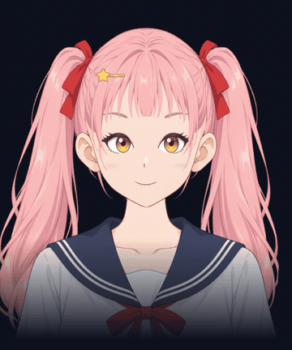

<div align="center">

# Iki

<h3>リギングまで自動でこなす、オープンな Live2D 代替エンジン。</h3>

<sub>息・生き・粋 — どれも「いき」</sub>

[English](./README.md) | 日本語 | [简体中文](./README.zh-CN.md)

[](https://www.npmjs.com/package/@ikijs/engine)
[](https://www.npmjs.com/package/@ikijs/format)
[](https://www.npmjs.com/package/@ikijs/mcp)
[](./plugin)
[](./plugin#codex)
[](https://zeikar.dev/iki/)
[](./LICENSE)
[](https://zeikar.dev/hyperclaude/)

</div>

この文書は英語版 README の翻訳です。内容に食い違いがある場合は英語版を正とします。

<table align="center">
  <tr>
    <th>文章ひとつから描く</th>
    <th colspan="3">完成した 1 枚絵から切り出す</th>
  </tr>
  <tr>
    <td><a href="https://zeikar.dev/iki/"></a></td>
    <td><a href="https://zeikar.dev/iki/playground/"></a></td>
    <td>→</td>
    <td><a href="https://zeikar.dev/iki/playground/"></a></td>
  </tr>
</table>

<p align="center"><sub>同じキャラクターを 2 つの方法で作りました。どちらも Iki の自動リガーによるもので、手作業のリギングは一切していません。<a href="https://zeikar.dev/iki/">デモを見る</a>。</sub></p>

**Iki** は、動く 2D キャラクターを Web ページ上で再生する、MIT ライセンスの無料エンジンです。Live2D や [Inochi2D](https://inochi2d.com/) の代わりに使えます。自動リガーは、パーツ（顔、目、口、髪など）に分けたキャラクターを受け取り、それぞれが動くように組み上げます。ここで言う「リギング」とはこの作業のことです。キャラクターはまばたきし、視線を動かし、話し、顔を左右に向け、うなずき、髪も揺れます。

手元にあるものに合わせて、次のどれからでも始められます。

| 文章ひとつ                                                                                                      | 完成した 1 枚絵                                                                                                                   | 手持ちのレイヤー                                                                                                                                                          |
| --------------------------------------------------------------------------------------------------------------- | --------------------------------------------------------------------------------------------------------------------------------- | ------------------------------------------------------------------------------------------------------------------------------------------------------------------------- |
| キャラクターを頼むと、画像生成モデルが[パーツをすべて描き](#draw-every-part)、プラグインがリギングします。      | プラグインが[正面向きのバストアップをパーツに切り分け](#cut-a-picture-you-already-have)、各パーツに隠れていた部分も描き足します。 | パーツごとの PNG、または同じレイヤー構成のシンプルな PSD を[エディタで自動リギング](#auto-rig-layers-you-already-have)します。AI もインストールもアップロードも不要です。 |
| _必要なもの：_ Claude Code または Codex（AI コーディングアシスタント）と[プラグイン](#make-a-character-with-ai) | _必要なもの：_ Claude Code または Codex とプラグイン                                                                              | _必要なもの：_ ブラウザだけ                                                                                                                                               |

**インストールなしで今すぐ試せます：**
[エディタがサンプルキャラクターをリギングする様子を見る](https://zeikar.dev/iki/editor/?sample)
· [完成したキャラクターをプレイグラウンドで動かす](https://zeikar.dev/iki/playground/)

どの方法でも、できあがるのは 1 つの `.iki` ファイルです。テクスチャも含んだプレーンな JSON で、ファイルは作った人のものです。WebGL ランタイムが[どのブラウザでも再生](#play-a-model)し、アプリ側は口・視線・表情を設定してキャラクターを動かします。話す AI キャラクターのためのフレームワーク [Charivo](https://github.com/zeikar/charivo) もこの方式です。Charivo のライブデモでは、上のキャラクター [Twin](https://charivo.vercel.app/?character=twin) や、全身モデルの [Mint](https://charivo.vercel.app/?character=mint) と、チャット・音声・リップシンク付きで会話できます。

<a id="make-a-character-with-ai"></a>

## AI でキャラクターを作る

3 つの方法のうち 2 つは、同じプラグインを使います。画像生成モデルに**パーツをすべて描かせる**方法と、**手持ちの 1 枚絵をパーツに切り分ける**方法です。どちらでも、リギング済みの `.iki` モデルができます。[Claude Code](https://github.com/anthropics/claude-code) にプラグインを入れるには：

```
/plugin marketplace add zeikar/iki
/plugin install iki@iki
```

[Codex](https://github.com/openai/codex) の場合：

```bash
codex plugin marketplace add zeikar/iki
codex plugin add iki@iki
```

Codex では、新しいセッションを始めると読み込まれます。どちらにも同じものが入ります。プラグインの手順書（「スキル」）と、アシスタントが呼び出すツールサーバー（MCP サーバー）です。ローカルのチェックアウトから使う方法や前提条件は、[プラグインのインストールガイド](./plugin#codex)を参照してください。

<a id="draw-every-part"></a>

### パーツをすべて描かせる

キャラクターを頼みます。たとえば _「iki のキャラクターを作って。銅色のショートボブ、緑の目、制服」_。プラグインは次の順に進めます。

1. 画像生成モデルで各パーツを 1 枚ずつ**描きます**。顔、目、瞳、眉、口、鼻、前髪と後ろ髪、胴体です。
2. 1 枚のキャンバスに**合成してチェック**し（`compose_layers_from_parts`、`measure_layers`）、動かすと破綻する形を見つけます。
3. パーツを**リギング**します（`auto_rig_from_layers`）。まぶたが折りたたまれるまばたき、視線、リップシンク、顔の左右の向き・うなずき・首の傾き、眉、呼吸、髪の揺れを付け、`.iki` モデルに書き出します。

描画は Claude Code から使う場合でも [Codex CLI](https://github.com/openai/codex) の画像ツールで行うため、ChatGPT のプランで `codex login` しておく必要があります。画像は 1 枚ごとに課金され、生成にはそれぞれ数分かかります。キャラクター 1 体で 15〜20 枚です（良いほうを選ぶため 2 回描くパーツもあります）。Codex がない場合は、プラグインがプロンプトを渡すので、別の画像生成ツールで実行できます。ツールサーバーには Node 22 以降、レンダリング結果のチェックには Chrome・Edge・Chromium のいずれかが必要です。詳しくはプラグインの[前提条件](./plugin#prerequisites)を参照してください。

1 回の実行でできるのはたたき台です。実行したフォルダの `iki-char/iki-character.iki` に書き出されます（[開き方はこちら](#see-your-model-move)。リポジトリ内で実行する場合は `iki-char/` を `.gitignore` に追加してください）。このページ冒頭のキャラクターもたたき台から始まり、プラグインの `iki-character-loop` で仕上げたものです。

<a id="cut-a-picture-you-already-have"></a>

### 手持ちの 1 枚絵を切り分ける

完成した正面向きのイラストを 1 枚プラグインに渡します。たとえば _「この絵を動くようにリギングして：`my-character.png`」_。このページ冒頭近くの動画がその例です。`iki-import-illustration` スキルが、絵のどこに目・口・髪があるかを見つけ（`view_illustration_grid`）、元の位置のままレイヤーに切り分けて、各レイヤーに隠れていた部分を描き足し（`cut_layers_from_illustration`）、あとは上と同じようにリギングします。モデルは元の絵のピクセルをそのまま使うので、静止状態では元の絵そのものです。閉じた口は引き伸ばして開けるため、話すときは生成した口のほうがきれいに動きます（新しく口を描くかどうかは、スキルが事前に尋ねます）。

使えるのは、背景が透明または単色の、正面向きのバストアップです。両目が隠れておらず、顔の幅が絵の幅のおよそ 4 分の 1 以上ある必要があります。斜め向き（3/4 ビュー）、顔にかかる手や小物、ごちゃついた背景の絵は受け付けません。全身の絵では腕が胴体に描き込まれたままになり、顔も小さすぎるため、先にバストアップにトリミングしてください。あごの下は、目からあごまでの長さより少し多めに残します。あごのすぐ下で切ったものも受け付けません。

<a id="auto-rig-layers-you-already-have"></a>

## 手持ちのレイヤーを自動リギングする

すでにレイヤー分けされた絵なら、AI もインストールもいりません。[エディタ](https://zeikar.dev/iki/editor/)を開き、右側のパネルで **Import layer set** を押して、パーツごとの PNG か、同じレイヤー構成の PSD を選びます。自動リガーがブラウザ内でレイヤーを計測してリギングし、数秒で終わります。ファイルがブラウザの外に出ることはありません。**Export .iki** でモデルをダウンロードできます。手元に絵がない場合は、[サンプルのリギングを見る](https://zeikar.dev/iki/editor/?sample)か、エディタで **Try sample layers** を押してください。

どのパーツかはレイヤー名で決まります。レイヤーはすべて同じサイズで、各パーツはキャラクター上の位置に描きます。`Eye-L`、`eye l`、`eye_L.png` はどれも `eye_L` として読み込まれます。`_L` と `_R` はキャラクター自身から見た左右なので、`eye_L` は画面では右にあります。

| レイヤー                                                          | 内容                                                                                                                                                                                           |
| ----------------------------------------------------------------- | ---------------------------------------------------------------------------------------------------------------------------------------------------------------------------------------------- |
| `face`（必須）                                                    | 頭の肌。目は描かずにおきます                                                                                                                                                                   |
| `eye_L`、`eye_R`（必須）                                          | 左右の目。`iris_*`、`lash_*`、`lash_lower_*` を別レイヤーにした場合は白目だけを描きます。白目はまつ毛の下へ折りたたまれて閉じ、瞳（任意で `pupil_*` と `highlight_*`）は視線に合わせて動きます |
| `mouth`、または `mouth_inner` + `lip_lower` + `lip_upper`（必須） | 閉じた口。任意で `mouth_open` を用意すると、そちらへクロスフェードします。または、上下に開閉する唇のセット。任意で `mouth_teeth` と `mouth_tongue` も使えます                                  |
| `brow_L`、`brow_R`                                                | 眉。表情に合わせて上がったり角度が変わったりします                                                                                                                                             |
| `nose`                                                            | 顔とは別に描いた鼻。顔を左右に向けると、顔より大きく動きます                                                                                                                                   |
| `hair_front`、`hair_back`、`hair_side_L`、`hair_side_R`           | ばねで揺れる前髪と後ろ髪、そして耳の横に垂れる横髪（根元は前髪の下）（横髪には `hair_front` が必要です）                                                                                       |
| `body`、`arm_L`、`arm_R`                                          | 呼吸し、向きを変える胴体と、下ろした状態から上げたり曲げたりできる腕（腕には `body` が必要です）                                                                                               |
| `blush_L`、`blush_R`                                              | 頬の赤み。普段は薄く、表情に合わせて濃くなります                                                                                                                                               |
| `forearm_pose_L`、`forearm_pose_R`                                | 上げた状態で描いたもう 1 本の前腕。手を振るときに差し替わります（腕が必要です）                                                                                                                |

リギングの出来は、パーツの分け方で決まります。目が描き込まれた顔や、ひとかたまりの髪では、別々に動かせるものがありません。PSD は、これらのレイヤーを単純に重ねただけのものにしてください。各レイヤーは表示状態のラスターパーツ 1 つで、パーツ名が付いており、描画モードは通常、不透明度は 100% にします。背景やラフのレイヤーは削除し、グループ、マスク、クリッピングしたレイヤー、レイヤー効果は各パーツに統合してください。テキスト、シェイプ、スマートオブジェクト、調整レイヤーも受け付けず、該当するレイヤー名を示してエラーになります（8 bit RGB、最大 64 メガピクセル、PSB は非対応）。統合済みの 1 枚絵なら、上の[切り分け](#cut-a-picture-you-already-have)を使ってください。

エージェントやスクリプトからは、[`@ikijs/mcp`](./packages/mcp) の `auto_rig_from_layers` に PNG のパスを渡せば同じことができます。どちらの裏側でも動いている関数は、[`@ikijs/editor`](./packages/editor#auto-rig) の `generateIkiFromLayerSet` です。

<a id="see-your-model-move"></a>

## モデルを動かしてみる

どの方法でも、最後は `.iki` ファイルになります。エディタでは **Export .iki** でダウンロードでき、プラグインは実行したフォルダ（通常は `iki-char/` の下）に書き出します。[プレイグラウンド](https://zeikar.dev/iki/playground/)を開き、**Model** リストで **Load a .iki file…** を選んでください。**Idle** をオンにしておくと、まばたきしたり視線を動かしたりする様子を見られます。表情のボタンを押したり、スライダーを動かして自分でポーズを付けたりもできます（スライダーを動かすと Idle はオフになります）。自分のページに組み込むには、[モデルを再生する](#play-a-model)を参照してください。

<a id="play-a-model"></a>

## モデルを再生する

`.iki` ファイルは、WebGL2 ランタイムの [`@ikijs/engine`](./packages/engine) が、自分のページの `<canvas>` 上で再生します。

```bash
npm install @ikijs/engine @ikijs/format
```

```ts
import { IkiMotion, IkiPlayer } from "@ikijs/engine";
import { loadIkiModel, StandardParameter } from "@ikijs/format";

const canvas = document.querySelector("canvas")!;
// 自分のファイル、または手始めにこのファイル（ページ冒頭のキャラクター）。
const url = "https://zeikar.dev/iki/playground/hero.iki";
const model = loadIkiModel(await (await fetch(url)).text());

const player = new IkiPlayer(canvas);
await player.load(model);

// ひとりでに動く：まばたき、呼吸、さまよう視線、髪の揺れ。
const motion = new IkiMotion(
  model,
  (id) => player.getParameter(id),
  (id, value) => player.setParameter(id, value),
);

let mouthOpen = 0; // 0〜1、リップシンクから

const tick = (now: number) => {
  motion.update(now);
  // アプリから動かす値は update() の後に設定し、こちらを優先させる。
  player.setParameter(StandardParameter.MouthOpen, mouthOpen);
  requestAnimationFrame(tick);
};
requestAnimationFrame(tick);
// tick の後に開始するので、各フレームは直前に設定したポーズで描かれる。
player.start();
```

組み込みに必要なのは、このモジュールスクリプトだけです。canvas に CSS でサイズを指定すれば、プレイヤーがその大きさいっぱいに描画します。エンジンはアプリについて何も知りません。アプリがパラメータ（口の開きや顔の角度など、名前の付いたスライダー）を設定し、エンジンはそれを描くだけです。自動リギングしたモデルはどれも同じ[標準パラメータ ID](./packages/format/src/parameters.ts) に反応するので、モデルごとに対応付ける必要はありません。`motion.playExpression("smile")` や `motion.playMotion("Nod", 0)` で、モデルに定義された表情やモーションを再生できます。`motion.setGazeTarget(x, y)` は目を 1 点（x、y とも -1〜1）に向けたままにし、顔もそれを追います。全身モデルの画角は `player.setView` で調整します（[`@ikijs/engine`](./packages/engine#usage)）。

WebGL2 が動く環境ならどこでも動きます。ブラウザ、Electron のウィンドウ、OBS のブラウザソースなどです。ネイティブ版や Unity 版のランタイムはありません。

話すキャラクターを作るなら、このループを自分で書く必要はありません。Charivo のアプリでは、[`@charivo/render-iki`](https://www.npmjs.com/package/@charivo/render-iki) が `.iki` モデルのレンダラーになり、Charivo のチャット・音声・リップシンク・表情がモデルを動かします。

<a id="what-it-is-not-yet"></a>

## まだできないこと

Iki はまだ初期段階（0.x）です。キャラクターをリギングして再生するものであり、VTuber アプリではありません。Web カメラによるフェイストラッキングはないので、キャラクターを動かすものが別に必要です。自分のコードか、[Charivo](https://github.com/zeikar/charivo) のようなホストアプリです。キャラクターは正面向きで、左右に 30° ほど顔を向けられますが、3D のように一回転はしません。Live2D のモデルは読み込めません。また、1.0 までは `.iki` 形式が変わる可能性があり、新しいリリースが古いリリースで保存したモデルを受け付けないこともあります（[詳細](./packages/format#stability)）。

<a id="how-iki-compares"></a>

## 他ツールとの比較

Live2D Cubism は業界標準で、エディタ、ツール、エコシステム、そしてリギングで到達できるクオリティの上限など、アーティストにとって重要なあらゆる面で Iki よりはるかに成熟しています。[Inochi2D](https://inochi2d.com/) は、この分野で実績のあるオープンソースプロジェクトです。Iki はどちらも置き換えるつもりはありません。Iki が作られたのは、求めていた 3 つの条件をすべて満たすものがなかったからです。制約の少ないライセンス、プレーンテキストの形式、そしてエージェントが組めるリグです。

- **AI エージェントが作れるキャラクター。** パーツ画像を入れると、リギング済みのモデルが出てきます。Claude Code / Codex のプラグインでも、任意の MCP クライアントでも使えます。Iki が本当に探求しているのはこの部分です。
- **商用利用も無料。** MIT ライセンスです。出版許諾契約も、売上に応じた区分もありません。
- **オープンな形式。** `.iki` モデルは、型付きで検証済みのプレーンな JSON で、ファイルは作った人のものです。モデルの自動生成が現実的になるのも、この形式のおかげです。
- **Web ネイティブ。** TypeScript で書かれた WebGL ランタイムで、ネイティブのツールチェーンは不要です。

|                           | Live2D Cubism                                                                                                   | Inochi2D                         | Iki                                                                                                     |
| ------------------------- | --------------------------------------------------------------------------------------------------------------- | -------------------------------- | ------------------------------------------------------------------------------------------------------- |
| ライセンス                | 独自の SDK ライセンス。配布には出版許諾契約が必要で、個人と小規模事業者は免除されます（[規約][live2d-license]） | BSD-2-Clause                     | **MIT** — 商用利用も無料                                                                                |
| エディタ                  | Cubism Editor（有料の PRO 版と無料の FREE 版）                                                                  | Inochi Creator（オープンソース） | レイヤーを自動リギングするブラウザ版エディタと、ツール開発向けの編集ライブラリ（初期段階）              |
| モデル形式                | `.moc3`、コンパイル済みの独自形式                                                                               | オープン                         | プレーンな JSON、型付きで検証済み                                                                       |
| ランタイム                | Web SDK を含むネイティブ SDK                                                                                    | ネイティブ（D 言語）             | TypeScript + WebGL2、`npm install`                                                                      |
| AI エージェントが作れるか | —                                                                                                               | —                                | はい。Claude Code / Codex のプラグインが、キャラクターを描くか 1 枚絵から切り出し、リギングまで行います |
| 成熟度                    | 業界標準                                                                                                        | 実績あり                         | 初期段階（0.x、スキーマはまだ固まっていません）                                                         |

[live2d-license]: https://www.live2d.com/en/sdk/license/

いますぐ本番品質の 2D リギングが必要なら、Cubism を使ってください。スクリプトから扱えるオープンな Web 向け形式が欲しいなら、Iki はまさにそのためのプロジェクトです。

<a id="packages"></a>

## パッケージ

| パッケージ                                       | 内容                                                                                                                     |
| ------------------------------------------------ | ------------------------------------------------------------------------------------------------------------------------ |
| [`@ikijs/engine`](./packages/engine)             | `.iki` モデルを再生する WebGL2 ランタイム                                                                                |
| [`@ikijs/format`](./packages/format)             | `.iki` 形式：型、ローダー、バリデーター                                                                                  |
| [`@ikijs/editor`](./packages/editor)             | 自動リガーと、画面を持たない編集コア（コマンド、元に戻す・やり直し）。ツール開発向け                                     |
| [`@ikijs/mcp`](./packages/mcp)                   | AI アシスタントが呼び出すツールサーバー（MCP）：パーツの合成とチェック、1 枚絵の切り分け、リギング、ポーズのレンダリング |
| [`plugin/`](./plugin)                            | Claude Code / Codex のプラグイン：キャラクター用スキルとツールサーバーを一度にインストール                               |
| [Playground](https://zeikar.dev/iki/playground/) | 6 体のテストモデルをスライダーで動かせるほか、自分の `.iki` ファイルも読み込めます（[ソース](./examples/playground)）    |
| [Editor](https://zeikar.dev/iki/editor/)         | レイヤーの自動リギング、パーツ・デフォーマ・物理演算の編集、`.iki` の書き出し（[ソース](./examples/editor)）             |

<a id="quick-start-this-repo"></a>

## クイックスタート（このリポジトリ）

Node 22.13 以降と pnpm 11 が必要です。

```bash
pnpm install
pnpm build
pnpm playground   # Vite の URL を開いてスライダーを動かす
```

<a id="the-iki-format"></a>

## `.iki` 形式

モデルは 1 つの JSON ドキュメントです。奥から手前の順に描くパーツのフラットなリスト、それを動かすパラメータ、そして任意のデフォーマ、物理演算、表情、モーションクリップで構成されます。ツールが書き出したモデルには、どのバージョンで作られたか（`generator`）も記録されます。スキーマの型、手書きの小さな例、左右の決まり、安定性のルールは [`@ikijs/format`](./packages/format#the-model) にあります。

<a id="faq"></a>

## FAQ

**Iki は商用利用できますか？** はい。このリポジトリのすべてが MIT ライセンスです。作ったモデルは作った人のものです。

**Iki は AI でリギングするツールですか？** リギングは自動で、それを AI エージェントが動かします。エージェントはパーツを描くか切り分け、チェック結果を読み、リグの設定を調整し、ツインテールのような標準の名前がないパーツをリギングします。リガー自体はレイヤーのピクセルから形を計測する仕組みで、ダウンロードが必要な学習済みモデルもありません。だからブラウザ上で AI なしでも動きます。

**PSD を自動でリギングできますか？** はい、シンプルなものなら。パーツ名の付いたレイヤーで、グループ・マスク・レイヤー効果を統合してあるものです。[手持ちのレイヤーを自動リギングする](#auto-rig-layers-you-already-have)を参照してください。

**1 枚絵からリギングできますか？** はい、プラグインを使えば。完成した正面向きのイラストを 1 枚[レイヤーに切り分け](#cut-a-picture-you-already-have)、それをリギングします。絵を読み取るには AI コーディングアシスタントが必要で、アップロードするだけで済む仕組みはありません。

**Live2D のモデルを読み込めますか？** いいえ。`.moc3` はコンパイル済みの独自形式です。Iki は自前のオープンな形式を使っており、Live2D モデルのインポーターはありません。

**エディタは必須ですか？** いいえ。[モデルを再生する](#play-a-model)だけなら `@ikijs/engine` と `@ikijs/format` で足ります。エディタアプリはレイヤーを自動リギングする場所で、`@ikijs/editor` はオーサリングツールを作るためのものです。

<a id="roadmap"></a>

## ロードマップ

[ROADMAP.md](./ROADMAP.md) に、実装済みの機能と後回しにした機能をまとめています。

<a id="license"></a>

## ライセンス

MIT © Zeikar
