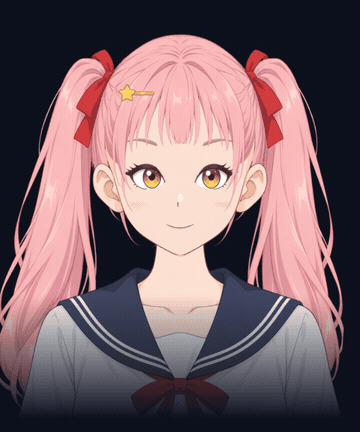
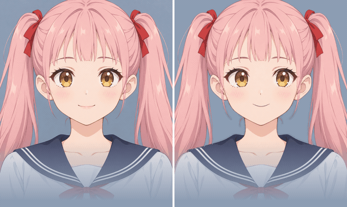

# Iki

[](https://www.npmjs.com/package/@ikijs/engine)
[](https://www.npmjs.com/package/@ikijs/format)
[](https://www.npmjs.com/package/@ikijs/mcp)
[](./plugin)
[](./plugin#codex)
[](https://zeikar.dev/iki/)
[](./LICENSE)
[](http://zeikar.dev/hyperclaude/)

<p align="center">
  
  <br />
  <sub>Parts drawn by an image model and rigged by Iki's auto-rigger, with no hand rigging. <a href="https://zeikar.dev/iki/">See it live</a>.</sub>
</p>

<h3 align="center">The open Live2D alternative that rigs itself.</h3>

> 息 (breath) · 生き (life) · 粋 (chic)

**Iki** is a free, MIT-licensed 2D puppet animation engine for the web — an
alternative to Live2D and [Inochi2D](https://inochi2d.com/) whose characters an
AI agent can make: AI rigging for 2D characters. Its auto-rigger turns art into a character that blinks,
looks around, talks, turns and nods, with hair that sways, from any of three
starting points:

- **A sentence.** Ask the bundled [Claude Code / Codex plugin](./plugin) for a
  character and an image model [draws its parts](#draw-every-part).
- **One finished picture.** The plugin
  [cuts it into parts](#cut-a-picture-you-already-have) and fills in what each
  part hides.
- **Layers you already have.** One PNG per part, or a PSD of the same layers,
  is [rigged as it is](#auto-rig-layers-you-already-have), in the browser, with
  no AI and no install.

What you get is an open `.iki` file — plain JSON you own — that the
WebGL runtime plays in any browser, and that a host (such as
[Charivo](https://github.com/zeikar/charivo)) drives from lip-sync, gaze and
expressions.

> Status: **early, but real.** The runtime renders parameter-driven color quads,
> atlas-sampled texture parts, warp-mesh and grid deformation, stencil clipping
> masks and part occlusion, and spring/chain physics. The editor authors parts,
> deformers, and physics rigs; the generator rigs a character from role-named
> PNG layers (or a PSD, in the editor), including through an MCP server that AI
> agents can drive.

## Make a character with AI

Two of the three ways in go through one plugin: have an image model **draw every
part**, or **cut a picture you already have** into parts. Either way you get a
rigged `.iki` model. Install the plugin in
[Claude Code](https://github.com/anthropics/claude-code):

```
/plugin marketplace add zeikar/iki
/plugin install iki@iki
```

Or in [Codex](https://github.com/openai/codex):

```bash
codex plugin marketplace add zeikar/iki
codex plugin add iki@iki
```

Start a new Codex session to load it. The same skills and MCP server work in
both hosts; see the [plugin installation guide](./plugin#codex) for a local
checkout and prerequisites.

### Draw every part

Ask for a character — _"make me an iki character: short copper bob, green
eyes, school uniform"_. The plugin:

1. **Draws** each part on its own with an image model — face, eyes, irises,
   brows, mouth, nose, front and back hair, torso.
2. **Composes and checks** them on one canvas (`compose_layers_from_parts`,
   `measure_layers`), catching the geometry that would break in motion.
3. **Rigs** them (`auto_rig_from_layers`): eyelid-fold blink, gaze, lip-sync,
   head turn, nod and tilt, brows, breathing and hair physics, written to a
   `.iki` model.

The character at the top of this page was made this way. The plugin needs an
image generator — see its [prerequisites](./plugin#prerequisites).

### Cut a picture you already have

<p align="center">
  
  <br />
  <sub>One finished picture, left, and the model cut from it, right: the hero's character, made the other way.</sub>
</p>

Hand the plugin one finished, front-facing picture — _"rig this picture so it
moves: `my-character.png`"_. Its `iki-import-illustration` skill reads
landmarks off it (`view_illustration_grid`), cuts it into layers in place and
fills in what each layer hides (`cut_layers_from_illustration`), then rigs
them as above. The model keeps the picture's own pixels, so at rest it is your
picture; a closed mouth is stretched open to talk, and a generated mouth talks
more cleanly (the skill asks before drawing one). A clean front-facing bust
works best.

## Auto-rig layers you already have

Art already separated into layers needs no AI and no install. Open the
[editor](https://zeikar.dev/iki/editor/), press **Import layer set**, and pick
one PNG per part, or a PSD of the same layers. The auto-rigger measures them
and rigs them in the browser, in seconds, and the files never leave it.
**Export .iki** saves the model.

Layers are matched by name, all on one canvas, each drawn where it sits.
`Eye-L`, `eye l` and `eye_L.png` all read as `eye_L`; `_L` and `_R` are the
character's own left and right, so `eye_L` is on the viewer's right.

| Layer                                                            | What it is                                                                                                                                                                                                |
| ---------------------------------------------------------------- | --------------------------------------------------------------------------------------------------------------------------------------------------------------------------------------------------------- |
| `face` (required)                                                | The head's skin, drawn without the eyes                                                                                                                                                                   |
| `eye_L`, `eye_R` (required)                                      | Each eye. With `iris_*`, `lash_*` and `lash_lower_*` as layers of their own, the eye white alone: it folds shut under the lash, and the iris (with optional `pupil_*` and `highlight_*`) follows the gaze |
| `mouth`, or `mouth_inner` + `lip_lower` + `lip_upper` (required) | A closed mouth, with an optional `mouth_open` to cross-fade to; or a lip set that folds open, with optional `mouth_teeth` and `mouth_tongue`                                                              |
| `brow_L`, `brow_R`                                               | Brows, raised and angled by expressions                                                                                                                                                                   |
| `nose`                                                           | A nose drawn apart from the face, so it leads the head turn                                                                                                                                               |
| `hair_front`, `hair_back`, `hair_side_L`, `hair_side_R`          | Bangs and back hair, which sway on springs, and the locks beside the ears, rooted under the bangs (they need `hair_front`)                                                                                |
| `body`, `arm_L`, `arm_R`                                         | The torso, which breathes and turns, and hanging arms that raise and bend (they need `body`)                                                                                                              |
| `blush_L`, `blush_R`                                             | A cheek blush that rests faint and deepens with an expression                                                                                                                                             |

The rig is only as good as the separation: a face with the eyes painted on, or
hair in one piece, has nothing to move apart. A PSD has to be a plain stack of
those layers: every layer one visible raster part, named by role, at normal
blend and full opacity. Delete a background or sketch layer, and merge groups,
masks, clipped layers and effects into their part; text, shape, smart-object
and adjustment layers are refused too, each by name (8-bit RGB, up to 64
megapixels, no PSB). For one flattened picture, use
[the cut](#cut-a-picture-you-already-have) above.

An agent or a script does the same from PNG paths with `auto_rig_from_layers`
in [`@ikijs/mcp`](./packages/mcp), which also reports folds and physics, and
the function under both is `generateIkiFromLayerSet` in
[`@ikijs/editor`](./packages/editor#auto-rig).

## Try it

No install — both demos run in the browser:

- **[Playground](https://zeikar.dev/iki/playground/)** — drag the sliders
  that a host would drive, on a hand-authored model or one of the six
  regression-corpus characters — the hero with her baked twin tails, the same
  character cut from one picture, three full bodies and a plain bust.
- **[Editor](https://zeikar.dev/iki/editor/)** — auto-rig a layered PSD or
  named PNG layers, author parts, deformers, and physics rigs, and export a
  validated `.iki`.

## Why

- **Characters an AI agent can build.** Part images in, a rigged model that
  blinks, talks, turns and nods out — through the Claude Code / Codex plugin or any MCP
  client. That is the part Iki is really exploring.
- **Free for commercial use.** MIT: no publication license, no revenue tiers —
  ship whatever you build with it.
- **Open format.** The `.iki` model is a plain, documented JSON schema you own —
  which is what makes generating a model tractable in the first place.
- **Web-native.** WebGL runtime, TypeScript, no native toolchain.
- **Host-agnostic.** The engine knows nothing about Charivo or any host; it
  just plays `.iki` models. Charivo consumes it through a thin `render-iki`
  adapter, the same way it consumes the Live2D SDK today.

## How Iki compares

Live2D Cubism is the industry standard, and it is far more mature than Iki in
every dimension that matters to an artist — editor, tooling, ecosystem, and the
quality ceiling of what you can rig with it. [Inochi2D](https://inochi2d.com/)
is the established open-source project in this space. Iki is not trying to
replace either. It exists because three things it wanted never lined up in one
place: a permissive license, a plain-text format, and a rig an agent can build.

|                          | Live2D Cubism                                                                                                                                            | Inochi2D                     | Iki                                                                                                                                                                                                     |
| ------------------------ | -------------------------------------------------------------------------------------------------------------------------------------------------------- | ---------------------------- | ------------------------------------------------------------------------------------------------------------------------------------------------------------------------------------------------------- |
| License                  | Proprietary SDK license; a publication license is required to distribute, with exemptions for individuals and small businesses ([terms][live2d-license]) | BSD-2-Clause                 | **MIT** — free for commercial use                                                                                                                                                                       |
| Editor                   | Cubism Editor (paid PRO tier, free tier)                                                                                                                 | Inochi Creator (open source) | Headless editor core + example app (early)                                                                                                                                                              |
| Model format             | `.moc3`, compiled and proprietary                                                                                                                        | Open                         | Plain JSON with a documented schema and a validator                                                                                                                                                     |
| Runtime                  | Native SDKs, including a Web SDK                                                                                                                         | Native (D)                   | TypeScript + WebGL2, `npm install`                                                                                                                                                                      |
| An AI agent can build it | —                                                                                                                                                        | —                            | Yes: a Claude Code / Codex plugin that draws and rigs a character, over an MCP server (`compose_layers_from_parts`, `measure_layers`, `auto_rig_from_layers`, `measure_turn_reference`, `render_poses`) |
| Maturity                 | Industry standard                                                                                                                                        | Established                  | Early (0.x, schema still settling)                                                                                                                                                                      |

[live2d-license]: https://www.live2d.com/en/sdk/license/

If you need production-grade 2D rigging today, use Cubism. If you want an open
web format you can script against, that is what this is.

## Packages

| Package                                                                                     | What it is                                                                                                                                                                                                                                                 |
| ------------------------------------------------------------------------------------------- | ---------------------------------------------------------------------------------------------------------------------------------------------------------------------------------------------------------------------------------------------------------- |
| [`@ikijs/format`](./packages/format)                                                        | The `.iki` model schema, types, loader, and validator                                                                                                                                                                                                      |
| [`@ikijs/engine`](./packages/engine)                                                        | WebGL2 runtime that plays a `.iki` model                                                                                                                                                                                                                   |
| [`@ikijs/editor`](./packages/editor)                                                        | Headless editing core (no UI): EditorDocument, edit commands, undo/redo, atlas layout/UV helpers, auto-rigger (depends only on @ikijs/format)                                                                                                              |
| [`@ikijs/mcp`](./packages/mcp)                                                              | stdio MCP server exposing `.iki` read/validate plus `compose_layers_from_parts`, `measure_layers`, `auto_rig_from_layers`, `measure_turn_reference`, `render_poses`, `probe_rig`, `view_illustration_grid` and `cut_layers_from_illustration` to AI agents |
| [`examples/playground`](./examples/playground) ([live](https://zeikar.dev/iki/playground/)) | Slider-driven demo of the six regression-corpus characters (the hero with her baked twin tails, the same character cut from one picture, three full bodies and a plain bust) and a hand-authored model                                                     |
| [`examples/editor`](./examples/editor) ([live](https://zeikar.dev/iki/editor/))             | Private React+Zustand app — load/import art, numeric part + deformer + physics editing, pivot gizmo, live IkiPlayer preview, validated .iki export                                                                                                         |
| [`plugin/`](./plugin)                                                                       | Claude Code / Codex plugin — shared character-generation skills, two agent roles, and the MCP server, wired up in one install                                                                                                                              |

## Install

```bash
npm install @ikijs/engine @ikijs/format
```

`@ikijs/editor` is for building authoring tools; `@ikijs/mcp` runs as a
server (`npx -y @ikijs/mcp`) rather than being imported.

## Quick start (this repo)

```bash
pnpm install
pnpm build
pnpm playground   # open the Vite URL and drag the sliders
```

## The `.iki` model

A model is a flat list of parts composited back-to-front, plus parameters wired
to those parts through linear bindings:

```ts
import { StandardParameter, type IkiModel } from "@ikijs/format";

const model: IkiModel = {
  version: 1,
  name: "Hello",
  canvas: { width: 1000, height: 1000 },
  parameters: [{ id: StandardParameter.MouthOpen, min: 0, max: 1, default: 0 }],
  parts: [
    {
      id: "mouth",
      color: [0.78, 0.32, 0.36, 1], // solid fill, or tint multiplier when a texture is present
      width: 150,
      height: 34,
      order: 0,
      transform: { x: 0, y: -150 },
      bindings: [
        {
          parameter: StandardParameter.MouthOpen,
          channel: "scaleY",
          from: 0,
          to: 3,
        },
      ],
    },
  ],
};
```

Stick to the `StandardParameter` ids (`ParamMouthOpenY`, `ParamAngleX`, …) so
any host can drive any model without per-model wiring. `Left`/`Right` in those
ids name the **character's** side, so the character's left eye is the part at
positive x (the viewer's right).

A model can also declare expressions and motion clips, each with a description.
A host plays an expression by its id and a clip by its group and index.

> **Stability:** `IKI_FORMAT_VERSION` identifies the `.iki` contract, and from
> 1.0 on, any breaking schema change bumps it. Until then the v1 schema is still
> settling: a 0.x release may tighten validation and reject a model an earlier
> one accepted (canvas extents must now be `> 0`, for instance). Such changes
> are called out in the changelog. The TypeScript surface can likewise shift
> between 0.x minors.

## FAQ

**Can I use this commercially?** Yes — MIT, for everything in this repo. Models
you make are yours.

**Can it load Live2D models?** No. `.moc3` is a proprietary compiled format;
Iki has its own open schema and no importer for it.

**Is it production ready?** Not yet — the packages are published from 0.1.0 and
the v1 schema is still settling. See **Stability** above for what that means for
a model you save today.

**Do I need the editor to use it?** No. `@ikijs/engine` + `@ikijs/format` are
enough to play a model. The editor packages are for building authoring tools,
and the editor app is where you auto-rig layers.

**How do I make a model?** Ask for one with the
[Claude Code / Codex plugin](#make-a-character-with-ai), which draws the parts and rigs
them, or [cuts a finished picture of yours](#cut-a-picture-you-already-have)
into them. With art already in layers,
[auto-rig them](#auto-rig-layers-you-already-have) in the editor. Or hand-write
the JSON — it is small, see above.

**Is this AI rigging?** The rigging is automatic, and an AI agent drives it: it
draws or cuts the parts, reads the checks, tunes the rig plan and rigs the
parts that have no role, such as twin tails. The rigger itself is geometry
measured from the layers' pixels, with no model to download, which is why it
also runs in the browser with no AI at all.

**Can it auto-rig a PSD?** Yes, a simple one. Name the layers by role (`face`,
`eye_L`, `hair_front`, …), merge groups, masks and effects into them at normal
blend and full opacity, delete any background or sketch layer, and import the
PSD, or the same layers as PNGs, in the
[editor](https://zeikar.dev/iki/editor/): blink, gaze, lip-sync, head turn,
brows and hair physics are wired for you. See
[Auto-rig layers you already have](#auto-rig-layers-you-already-have).

**Can it rig a single image?** Yes, through the plugin: it
[cuts one finished, front-facing picture](#cut-a-picture-you-already-have)
into layers and rigs those. It needs an AI agent to read the picture; there is
no one-click upload.

## Roadmap

[ROADMAP.md](./ROADMAP.md) tracks what has landed and what is deferred.

## License

MIT © Zeikar
