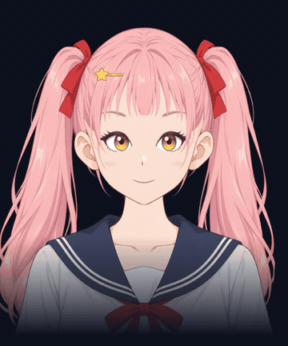

<div align="center">

# Iki

<h3>能自动绑定的开源 Live2D 替代方案。</h3>

<sub>息（呼吸）· 生き（生命）· 粋（潇洒）——日语里都读作 iki</sub>

[English](./README.md) | [日本語](./README.ja.md) | 简体中文

[](https://www.npmjs.com/package/@ikijs/engine)
[](https://www.npmjs.com/package/@ikijs/format)
[](https://www.npmjs.com/package/@ikijs/mcp)
[](./plugin)
[](./plugin#codex)
[](https://zeikar.dev/iki/)
[](./LICENSE)
[](https://zeikar.dev/hyperclaude/)

</div>

本文译自英文版 README，内容如有出入，以英文版为准。

<table align="center">
  <tr>
    <th>从一句话画出</th>
    <th colspan="3">从一张画好的图切出</th>
  </tr>
  <tr>
    <td><a href="https://zeikar.dev/iki/"></a></td>
    <td><a href="https://zeikar.dev/iki/playground/"></a></td>
    <td>→</td>
    <td><a href="https://zeikar.dev/iki/playground/"></a></td>
  </tr>
</table>

<p align="center"><sub>同一个角色，用两种方法各做了一遍，都由 Iki 的自动绑定器完成绑定，全程无需手动绑定。<a href="https://zeikar.dev/iki/">查看在线演示</a>。</sub></p>

**Iki** 是一个免费、采用 MIT 许可的引擎，用来在网页里播放 2D 动画角色，可以替代 Live2D 和 [Inochi2D](https://inochi2d.com/)。把拆分成部件（脸、眼睛、嘴、头发……）的角色交给自动绑定器，它会把这些部件串起来，让它们动起来。这里说的“绑定”（rigging，Live2D 圈也常叫“建模”）就是这个意思：角色会眨眼、四处张望、说话、转头和点头，头发也会随之摆动。

手上有什么，就从哪里开始：

| 一句话                                                                                 | 一张画好的图                                                                                    | 现成的图层                                                                                                                                       |
| -------------------------------------------------------------------------------------- | ----------------------------------------------------------------------------------------------- | ------------------------------------------------------------------------------------------------------------------------------------------------ |
| 描述你想要的角色，图像生成模型就会[画出每个部件](#draw-every-part)，再由插件完成绑定。 | 插件[把一张正面半身像切成部件](#cut-a-picture-you-already-have)，并补画出每个部件被遮住的部分。 | 每个部件一张 PNG，或者由同样这些图层组成的简单 PSD，都能[在编辑器里完成绑定](#auto-rig-layers-you-already-have)：不用 AI，不用安装，也不用上传。 |
| _需要：_ Claude Code 或 Codex（AI 编程助手），加上[插件](#make-a-character-with-ai)    | _需要：_ Claude Code 或 Codex，加上插件                                                         | _需要：_ 一个浏览器就够                                                                                                                          |

**无需安装，马上试试：**

- [在 Charivo 里看 Twin 和 Mint 做出反应、开口说话（带语音）](https://zeikar.dev/charivo/playground/)
- [看编辑器绑定一个示例角色](https://zeikar.dev/iki/editor/?sample)
- [在 Playground 里操控一个做好的角色](https://zeikar.dev/iki/playground/)

无论走哪条路，最终都会得到一个 `.iki` 文件：归你所有的纯 JSON，贴图也包含在内。WebGL 运行时可以[在任何浏览器里播放它](#play-a-model)，你的应用通过设置嘴部、视线和表情来驱动它。[Charivo](https://github.com/zeikar/charivo) 就是这样做的，它是一个用于打造会说话的 AI 角色的框架。在它的在线演示里，你可以和上面这个角色 [Twin](https://charivo.vercel.app/?character=twin) 对话，也可以和全身角色 [Mint](https://charivo.vercel.app/?character=mint) 对话，支持文字聊天、语音和口型同步。

<a id="make-a-character-with-ai"></a>

## 用 AI 制作角色

三种入门方式中，有两种通过同一个插件完成：让图像生成模型**画出每个部件**，或者把**你已有的图切成部件**。两种方式都会得到一个绑定好的 `.iki` 模型。在 [Claude Code](https://github.com/anthropics/claude-code) 里安装插件：

```
/plugin marketplace add zeikar/iki
/plugin install iki@iki
```

或者在 [Codex](https://github.com/openai/codex) 里安装：

```bash
codex plugin marketplace add zeikar/iki
codex plugin add iki@iki
```

装好后新开一个 Codex 会话即可加载。两边装上的东西相同：插件的说明（“技能”），以及助手调用的工具服务器（一个 MCP 服务器）。如果要从本地克隆的仓库安装，或想了解前置条件，见[插件安装指南](./plugin#codex)。

<a id="draw-every-part"></a>

### 画出每个部件

描述你想要的角色，比如：_“给我做一个 iki 角色：铜棕色短波波头，绿色眼睛，穿校服”_。插件会：

1. **绘制**：用图像生成模型逐个单独画出各个部件，包括脸、眼睛、虹膜、眉毛、嘴、鼻子、前发和后发、躯干。
2. **合成并检查**：把它们放到同一张画布上（`compose_layers_from_parts`、`measure_layers`），提前发现一动起来就会出问题的几何错误。
3. **绑定**：用 `auto_rig_from_layers` 完成眼睑折叠式眨眼、视线、口型同步、转头、点头和歪头、眉毛、呼吸以及头发摆动，并写入一个 `.iki` 模型。

绘制通过 [Codex CLI](https://github.com/openai/codex) 的图像工具完成，即使在 Claude Code 里也是如此，所以需要用 ChatGPT 订阅账号执行 `codex login`。每张图都单独计费，要花几分钟；一个角色需要十五到二十张图（有些部件会画两次，挑更好的那张）。没有 Codex 的话，插件会把提示词交给你，让你在别的图像工具里生成。工具服务器需要 Node 22 或更高版本，检查渲染结果需要 Chrome、Edge 或 Chromium。详见插件的[前置条件](./plugin#prerequisites)。

跑一遍会得到一份初稿，写到你运行插件的文件夹下的 `iki-char/iki-character.iki`（[打开它](#see-your-model-move)；如果是在代码仓库里运行，记得把 `iki-char/` 加进 `.gitignore`）。本页顶部的角色最初就是这样一份初稿，之后用插件的 `iki-character-loop` 打磨而成。

<a id="cut-a-picture-you-already-have"></a>

### 切分你已有的图

把一张画好的正面图交给插件，比如：_“帮我把这张图绑定好，让它动起来：`my-character.png`”_，就像本页顶部附近那段录屏一样。插件的 `iki-import-illustration` 技能会先找出图上眼睛、嘴和头发的位置（`view_illustration_grid`），再按原位切成图层，并补画出每个图层被遮住的部分（`cut_layers_from_illustration`），然后像上面一样完成绑定。模型保留原图本身的像素，所以静止时它就是你的原图。原图是闭嘴的话，说话时会直接把嘴拉开；换成生成的嘴，说话效果会更干净（技能会先征求你的同意再画）。

它需要一张正面半身像，背景透明或为纯色，双眼没有被遮挡，脸宽至少约为图片宽度的四分之一。四分之三侧面、手或道具挡住了脸、背景杂乱的图，都会被拒绝。全身图里的手臂仍然画在身体上，脸也会太小，所以要先裁成半身像：下巴以下保留的部分，要比眼睛到下巴的距离稍多一些。刚好裁到下巴下方的图同样会被拒绝。

<a id="auto-rig-layers-you-already-have"></a>

## 自动绑定你已有的图层

已经拆分好图层的素材，不需要 AI，也不需要安装。打开[编辑器](https://zeikar.dev/iki/editor/)，点右侧面板里的 **Import layer set**，为每个部件各选一张 PNG，或者由同样这些图层组成的 PSD。自动绑定器会在浏览器里测量并绑定它们，几秒就能完成，文件不会离开浏览器。点 **Export .iki** 下载模型。手边没有素材？可以[看它绑定一套示例图层](https://zeikar.dev/iki/editor/?sample)，或者在编辑器里点 **Try sample layers**。

每个图层用名字标明它是哪个部件。所有图层尺寸相同，每个部件都画在角色身上对应的位置。`Eye-L`、`eye l` 和 `eye_L.png` 都会被识别为 `eye_L`；`_L` 和 `_R` 指角色自己的左和右，所以 `eye_L` 在观众看来位于右侧。

| 图层                                                          | 说明                                                                                                                                                                   |
| ------------------------------------------------------------- | ---------------------------------------------------------------------------------------------------------------------------------------------------------------------- |
| `face`（必需）                                                | 头部的皮肤，不画眼睛                                                                                                                                                   |
| `eye_L`、`eye_R`（必需）                                      | 两只眼睛。如果 `iris_*`、`lash_*` 和 `lash_lower_*` 各自单独成层，这一层就只画眼白：它会在睫毛下方闭合，虹膜（可附带 `pupil_*` 瞳孔和 `highlight_*` 高光）跟随视线移动 |
| `mouth`，或 `mouth_inner` + `lip_lower` + `lip_upper`（必需） | 一张闭合的嘴，可另加一张 `mouth_open`，张嘴时淡入切换过去；或者一套能折叠张开的嘴唇，可附带 `mouth_teeth` 和 `mouth_tongue`                                            |
| `brow_L`、`brow_R`                                            | 眉毛，随表情抬起和倾斜                                                                                                                                                 |
| `nose`                                                        | 和脸分开画的鼻子，转头时位移比脸更大                                                                                                                                   |
| `hair_front`、`hair_back`、`hair_side_L`、`hair_side_R`       | 前发和后发，靠弹簧摆动；以及耳边的侧发，根部藏在前发下面（需要 `hair_front`）                                                                                          |
| `body`、`arm_L`、`arm_R`                                      | 躯干，会呼吸和转动；以及自然下垂的手臂，可以抬起和弯曲（需要 `body`）                                                                                                  |
| `blush_L`、`blush_R`                                          | 脸颊红晕，平时很淡，随表情加深                                                                                                                                         |
| `forearm_pose_L`、`forearm_pose_R`                            | 另画一只抬起的前臂，挥手时替换上去（需要对应的手臂）                                                                                                                   |

绑定的好坏取决于拆分：眼睛直接画在脸上，或者头发是一整块，就没有东西可以分开来动。PSD 必须是这些图层的简单堆叠：每个图层都是一个可见的栅格部件，以部件命名，混合模式为正常，不透明度 100%。删掉背景层和草稿层，把组、蒙版、剪贴蒙版和效果合并进各自的部件；文字、形状、智能对象和调整图层同样会被拒绝，并逐个报出图层名（限 8 位 RGB，最大 6400 万像素，不支持 PSB）。如果只有一张合并好的图，请用上面的[切分](#cut-a-picture-you-already-have)。

智能体或脚本可以用 [`@ikijs/mcp`](./packages/mcp) 里的 `auto_rig_from_layers`，从 PNG 路径做同样的事；两者底层都是 [`@ikijs/editor`](./packages/editor#auto-rig) 里的 `generateIkiFromLayerSet` 函数。

<a id="see-your-model-move"></a>

## 让你的模型动起来

每种方式最后都会得到一个 `.iki` 文件：编辑器的 **Export .iki** 会下载它，插件则把它写到你运行插件的文件夹里，通常在 `iki-char/` 下。打开 [Playground](https://zeikar.dev/iki/playground/)，在 **Model** 列表里选择 **Load a .iki file…**。保持 **Idle** 开启，就能看它眨眼、四处张望；也可以点一个表情，或者拖动滑块亲自摆姿势（这会关闭 Idle）。想把它放进你自己的网页，见[播放模型](#play-a-model)。

<a id="play-a-model"></a>

## 播放模型

`.iki` 文件由 [`@ikijs/engine`](./packages/engine) 播放。它是一个 WebGL2 运行时，在你自己页面的 `<canvas>` 上绘制模型：

```bash
npm install @ikijs/engine @ikijs/format
```

```ts
import { IkiMotion, IkiPlayer } from "@ikijs/engine";
import { loadIkiModel, StandardParameter } from "@ikijs/format";

const canvas = document.querySelector("canvas")!;
// 换成你自己的文件；想先试试，就用这个：本页顶部的那个角色。
const url = "https://zeikar.dev/iki/playground/hero.iki";
const model = loadIkiModel(await (await fetch(url)).text());

const player = new IkiPlayer(canvas);
await player.load(model);

// 让角色自己动起来：眨眼、呼吸、视线游移、头发摆动。
const motion = new IkiMotion(
  model,
  (id) => player.getParameter(id),
  (id, value) => player.setParameter(id, value),
);

let mouthOpen = 0; // 0 到 1，来自你的口型同步

const tick = (now: number) => {
  motion.update(now);
  // 应用要控制的参数放在 update() 之后设置，这样才能覆盖它。
  player.setParameter(StandardParameter.MouthOpen, mouthOpen);
  requestAnimationFrame(tick);
};
requestAnimationFrame(tick);
// 在 tick 之后启动，这样每一帧都用刚设好的姿势绘制。
player.start();
```

这就是全部的集成代码，放在 module 脚本里即可。给 canvas 设一个 CSS 尺寸，播放器就会填满它。引擎对你的应用一无所知：你设置参数（有名字的滑块，比如嘴部张合或头部角度），它负责绘制。所有自动绑定的模型都响应同一套[标准参数 id](./packages/format/src/parameters.ts)，所以不需要为每个模型单独适配；`motion.playExpression("smile")` 或 `motion.playMotion("Nod", 0)` 会播放模型里声明的表情或动作。`motion.setGazeTarget(x, y)` 让眼睛盯住一个点，x 和 y 的范围都是 -1 到 1，头部也会跟着转过去。全身模型用 `player.setView` 调整取景（[`@ikijs/engine`](./packages/engine#usage)）。

只要支持 WebGL2 就能运行：浏览器、Electron 窗口、OBS 的浏览器源。没有原生运行时，也没有 Unity 运行时。

如果角色要说话，这个循环不用你自己写。在 Charivo 应用里，[`@charivo/render-iki`](https://www.npmjs.com/package/@charivo/render-iki) 就是 `.iki` 模型的渲染器，由 Charivo 的聊天、语音、口型同步和表情来驱动它。

<a id="what-it-is-not-yet"></a>

## 目前还做不到的事

Iki 还处在早期阶段（0.x）。它能绑定和播放角色，但不是 VTuber 应用。它没有摄像头面部捕捉，所以需要有东西来驱动角色：你的代码，或者 [Charivo](https://github.com/zeikar/charivo) 这样的宿主应用。角色是正面视图，左右各能转大约 30°，做不到完整的 3D 转身。它不能加载 Live2D 模型。另外，在 1.0 之前 `.iki` 格式仍可能变化：新版本可能会拒绝旧版本保存的模型（[详情](./packages/format#stability)）。

<a id="how-iki-compares"></a>

## Iki 与同类工具对比

Live2D Cubism 是行业标准。在创作者最看重的每个方面，包括编辑器、工具链、生态，以及能绑定出的效果上限，它都比 Iki 成熟得多。[Inochi2D](https://inochi2d.com/) 是这个领域里成熟的开源项目。Iki 并不打算取代其中任何一个。它之所以存在，是因为它想要的三样东西从来没有凑到一起过：宽松的许可证、纯文本格式，以及能交给智能体来做的绑定。

- **AI 智能体能做出来的角色。** 输入部件图，输出绑定好的模型，可以通过 Claude Code / Codex 插件，也可以通过任何 MCP 客户端。这才是 Iki 真正在探索的部分。
- **可免费商用。** MIT：不需要出版许可，也没有按营收划分的档位。
- **开放格式。** `.iki` 模型是归你所有的纯 JSON，有类型、经过校验，也正因为如此，自动生成模型才变得可行。
- **为 Web 而生。** 用 TypeScript 写的 WebGL 运行时，不需要原生工具链。

|                   | Live2D Cubism                                                                   | Inochi2D               | Iki                                                                    |
| ----------------- | ------------------------------------------------------------------------------- | ---------------------- | ---------------------------------------------------------------------- |
| 许可证            | 专有 SDK 许可；分发需要出版许可，个人和小型企业可豁免（[条款][live2d-license]） | BSD-2-Clause           | **MIT**，可免费商用                                                    |
| 编辑器            | Cubism Editor（付费 PRO 版，另有免费版）                                        | Inochi Creator（开源） | 能自动绑定图层的浏览器编辑器，以及供工具使用的编辑库（早期）           |
| 模型格式          | `.moc3`，编译后的专有格式                                                       | 开放                   | 纯 JSON，有类型、经过校验                                              |
| 运行时            | 原生 SDK，包括一个 Web SDK                                                      | 原生（D 语言）         | TypeScript + WebGL2，`npm install`                                     |
| AI 智能体能否搭建 | —                                                                               | —                      | 能：Claude Code / Codex 插件可以画出角色，或从图中切出角色，再完成绑定 |
| 成熟度            | 行业标准                                                                        | 成熟                   | 早期（0.x，schema 仍在定型）                                           |

[live2d-license]: https://www.live2d.com/en/sdk/license/

如果你现在就需要生产级的 2D 绑定，请用 Cubism。如果你想要一个能用脚本操作的开放 Web 格式，Iki 就是为此而做的。

<a id="packages"></a>

## 软件包

| 包                                               | 说明                                                                            |
| ------------------------------------------------ | ------------------------------------------------------------------------------- |
| [`@ikijs/engine`](./packages/engine)             | 播放 `.iki` 模型的 WebGL2 运行时                                                |
| [`@ikijs/format`](./packages/format)             | `.iki` 格式：类型、加载器和校验器                                               |
| [`@ikijs/editor`](./packages/editor)             | 自动绑定器，以及一个不带界面的编辑核心（命令、撤销和重做），用于构建工具        |
| [`@ikijs/mcp`](./packages/mcp)                   | AI 助手调用的工具服务器（MCP）：合成并检查部件、切分图片、绑定、渲染姿势        |
| [`plugin/`](./plugin)                            | Claude Code / Codex 插件：角色技能和工具服务器一次装好                          |
| [Playground](https://zeikar.dev/iki/playground/) | 用滑块操控六个测试模型，或你自己的 `.iki` 文件（[源码](./examples/playground)） |
| [编辑器](https://zeikar.dev/iki/editor/)         | 自动绑定图层，编辑部件、变形器和物理，导出 `.iki`（[源码](./examples/editor)）  |

<a id="quick-start-this-repo"></a>

## 快速上手（本仓库）

需要 Node 22.13 或更高版本，以及 pnpm 11。

```bash
pnpm install
pnpm build
pnpm playground   # 打开 Vite 给出的地址，拖动滑块
```

<a id="the-iki-format"></a>

## `.iki` 格式

一个模型就是一份 JSON 文档：一个按从后往前顺序绘制的扁平部件列表、驱动这些部件的参数，以及可选的变形器、物理、表情和动作片段。由工具写出的模型还会记录生成它的工具版本（`generator`）。schema 的类型、一个手写的小示例、左右约定以及稳定性规则，都在 [`@ikijs/format`](./packages/format#the-model) 里。

<a id="faq"></a>

## 常见问题

**Iki 可以商用吗？** 可以。本仓库的全部内容都采用 MIT 许可。你做出来的模型归你所有。

**Iki 是用 AI 绑定的吗？** 绑定是自动完成的，由 AI 智能体来驱动：它负责画出或切出部件、读取检查结果、调整绑定设置，还会绑定那些没有标准名称的部件，比如双马尾。绑定器本身靠的是从图层像素中测量出的几何信息，没有需要下载的 AI 模型，所以它也能在完全不用 AI 的情况下在浏览器里运行。

**Iki 能自动绑定 PSD 吗？** 能，但要是简单的 PSD：图层按部件命名，组、蒙版和效果都已合并。见[自动绑定你已有的图层](#auto-rig-layers-you-already-have)。

**只有一张图片，能自动绑定吗？** 能，通过插件。插件会把[一张画好的正面图切成图层](#cut-a-picture-you-already-have)再绑定。它需要 AI 编程助手来读图，没有一键上传。

**Iki 能导入 Live2D 模型吗？** 不能。`.moc3` 是专有的编译格式；Iki 有自己的开放格式，也没有针对 `.moc3` 的导入器。

**使用 Iki 必须用编辑器吗？** 不必。有 `@ikijs/engine` 和 `@ikijs/format` 就足以[播放模型](#play-a-model)。编辑器应用用来自动绑定图层，`@ikijs/editor` 则用于构建创作工具。

<a id="roadmap"></a>

## 路线图

[ROADMAP.md](./ROADMAP.md) 记录了哪些功能已经落地、哪些被推迟。

<a id="license"></a>

## 许可证

MIT © Zeikar
